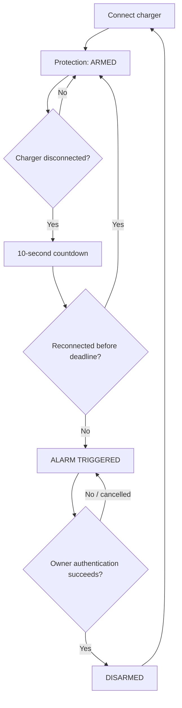

<!--
  ThiefAlertSeQure project overview
  Keep feature claims aligned with docs/FEATURE_COMPLETION_MATRIX.md,
  docs/PRIVACY_POLICY.md and docs/SECURITY_AND_PLATFORM_AUDIT.md.
-->

<div align="center">
  

  <h1>ThiefAlertSeQure</h1>
  <p><strong>Your charger. Your phone. Your control.</strong></p>
  <p>A privacy-first, on-device Android charging anti-theft alarm designed to make unauthorized charger removal harder to miss.</p>

  <p>
    <a href="https://github.com/alinor2pundamdag/ThiefAlertSeQure/actions/workflows/android.yml">
      
    </a>
    
    
    
    
  </p>
</div>

---

## 🛡️ A small layer of protection when your phone is charging

You leave your phone charging on a desk, at work, in a shared room, or beside your bed. If someone disconnects the charger and moves the phone, you may not notice immediately.

**ThiefAlertSeQure is designed to alert you when an armed phone is unplugged.** When the charger disconnects, the app starts a 10-second grace period. If the charger is not reconnected before the deadline, the alarm is triggered and remains active until the owner successfully authenticates.

It is a practical deterrent and awareness tool—not a guarantee against theft, physical tampering, or every Android system restriction.

## ✨ What makes it useful

| Benefit | What it means for the user |
|---|---|
| Charger-removal alert | Get an audible alarm when an armed phone is unplugged and remains disconnected through the countdown. |
| Automatic arming | Connecting the charger arms protection automatically. |
| Reconnect grace period | Reconnect within 10 seconds to cancel the pending alarm. |
| Authentication to disarm | A triggered alarm is cleared only after successful Android device-credential or supported strong-biometric verification. |
| Lock-screen unlock recovery | While the alarm service is active, Android keyguard dismissal on a secured device runs the same alarm-stop and charger-recovery flow; Android does not expose the exact unlock method to ordinary apps. |
| Persistent triggered state | Plugging the charger back in does not silence an already-triggered alarm. |
| Local-first privacy | No account, cloud backend, analytics service, advertising SDK, or Internet permission is configured. |
| Your own alarm sound | Choose supported audio through Android's system file picker; the packaged alarm is available as the built-in option. |
| Loud alarm behavior | The app requests the maximum alarm-stream volume Android reports and restores the previous level after successful disarm. Actual output remains device-dependent. |
| Optional motion alert | Enable a separate motion-triggered alarm when wanted. It is OFF by default. |
| Optional low-battery alert | Configure a battery threshold alert where supported by the app settings. |
| Local event history | Review recent protection events stored on the device and export them as CSV when you choose. |
| Optional managed-device hardening | Eligible, intentionally enrolled Android Enterprise devices can use Device Owner / Lock Task mode. |

## ⚡ How charger protection works



**Protection states**

- **DISARMED** — charger protection is inactive.
- **ARMED** — the app has observed the charger connection and is monitoring for removal.
- **COUNTDOWN** — charger removal was detected; the 10-second grace period is running.
- **ALARM_TRIGGERED** — the alarm is latched and requires successful owner authentication to clear.

The app revalidates charger state and countdown deadlines. After a reboot during a pending countdown, it checks the live charger state: if the charger is still absent, a fresh 10-second grace period starts; if connected, protection returns to ARMED. Unknown state is not treated as proof of unplugging.

## 🔐 Privacy is a design decision—not an afterthought

ThiefAlertSeQure is designed to do its essential work on your Android device.

### What the app does not do

- **No Internet permission** is declared in the app manifest.
- No account registration or sign-in.
- No cloud server, remote database, or cloud backup service.
- No configured advertising SDK or analytics tracker.
- No sale or advertising-based sharing of app-collected data.
- No collection of your device PIN, password, pattern, fingerprint data, or face templates.
- No location, contacts, SMS, camera, or microphone permission is requested by the current manifest.

### What stays on your device

The app keeps the operational data it needs in its private app storage, including:

- Protection state and countdown information.
- Biometric failure counter and temporary cooldown deadline.
- Your recorded privacy-notice choice.
- Alarm-volume value needed for restoration after successful disarm.
- A bounded local protection-event history.
- Monitor preferences, such as motion sensitivity and optional battery-alert threshold.
- References and Android access grants for audio files you explicitly select.

The event history can be exported only when you choose a destination through Android's document picker. Exported files are then handled by you and the destination you select.

### Your phone's credentials remain yours

When you disarm a triggered alarm, Android handles device PIN, pattern, or password verification through Keyguard. Supported strong biometrics are verified through Android's biometric framework.

**The app does not see or store the actual credential or biometric template.** Android remains responsible for protecting that information and enforcing its own credential lockout rules.

### Privacy notice and user choice

On first launch, the app presents separate **Accept & continue** and **Decline & continue** choices. The choice is recorded locally and distinctly. Both choices continue to the same essential local protection dashboard; declining is not misrepresented as consent. You can review the notice again in Settings.

Read the complete [Privacy Policy](docs/PRIVACY_POLICY.md).

## 🚨 Alarm, authentication, and reliability

- The built-in alarm audio is packaged inside the application and is played in a loop.
- If selected and packaged audio both fail, the current fallback is repeating vibration.
- The app requests the device's maximum reported alarm-stream volume while the alarm is active; it does not promise sound above the device's supported maximum.
- The previous alarm-stream volume is restored after successful disarm.
- A cancelled or failed authentication does not clear the triggered alarm.
- Five consecutive biometric failure callbacks start a 30-second app cooldown. After the cooldown, another group of five failures can start another cooldown.
- The biometric cooldown applies to the app's biometric flow. Android Keyguard independently controls device-credential lockout.
- Fingerprint and face authentication are accepted only when Android reports an enrolled **BIOMETRIC_STRONG** authenticator. Availability depends on the phone, Android version, hardware, and enrollment.

## 📱 Android and manufacturer compatibility

- **Minimum Android:** 8.0 (API 26).
- **Compile / target Android:** API 36 / API 36 (Android 16 target; Android 17 runtime compatibility).
- **Manufacturer-aware setup:** Samsung One UI, HONOR MagicOS, Huawei EMUI, Xiaomi / Redmi / POCO, OPPO, realme, OnePlus, vivo / iQOO, Google Pixel, Motorola, ASUS, Sony Xperia, Nothing OS, Lenovo, TECNO / Infinix / itel, ZTE / nubia, and safe generic Android guidance.
- **Settings fallback:** Public Android Settings action → app-specific settings → general Settings.
- **Android 15+:** Edge-to-edge safe insets are applied to the app's scrollable screens.
- **Android 17:** Background alarm audio remains inside the qualifying foreground-service architecture; Android 17 hardening still requires physical/emulator verification.

- **Interface:** Material-based dark UI with a scrollable layout, readable text sizing, and large touch targets.

See the full [Android Device Compatibility Matrix](docs/ANDROID_DEVICE_COMPATIBILITY.md) for API 26–37 behavior, OEM background controls, system-setting fallbacks, limitations, official manufacturer references, and physical-device acceptance tests.

No ordinary app can use one universal setting to override every manufacturer's power manager.

### Important Android system requirements

Some capabilities depend on system permissions and settings:

- **Notifications:** allow notifications where Android requests permission so the app can show its ongoing protection/alarm status.
- **Exact alarms:** Android 12+ controls exact-alarm access. If access is unavailable or revoked, an inexact fallback may be used and the 10-second alarm deadline can be delayed.
- **Battery/background controls:** manufacturer power management may restrict background work. Review the device's app battery and autostart controls.
- **Do Not Disturb:** the app does not silently change global DND settings. Configure Android's alarm exceptions and sound settings yourself.
- **After reboot:** recovery normally runs after Android delivers BOOT_COMPLETED, generally after the first device unlock. This app is not Direct-Boot-aware and cannot promise protection or alarm playback before that first unlock.
- **Lock-screen behavior:** Android notification, full-screen-intent, and lock-screen policies can affect how an alarm appears.

## 🧰 Optional Android Enterprise / Device Owner mode

For a device that is intentionally provisioned as a fully managed Android Enterprise device, ThiefAlertSeQure includes an optional managed mode using Android's official DevicePolicyManager and Lock Task APIs.

On supported builds, this can:

- Keep the app in Lock Task / kiosk mode.
- Hide the normal global-actions power dialog while Lock Task is active.
- Apply selected restrictions to Settings factory reset, safe boot, USB file transfer, adding users, and debugging.
- Provide an in-app action to exit managed mode and remove the policies.

**This is optional and is not enabled on an ordinary phone by default.** Device Owner status requires deliberate provisioning, usually on a new or factory-reset test device. The app cannot grant itself that status.

Managed mode is not invincible: it cannot guarantee protection against hardware forced shutdown, battery removal, bootloader/recovery reset, or OEM firmware controls. Read [Device Owner Mode and Rollback](docs/DEVICE_OWNER_MODE.md) before provisioning.

## 🚀 Getting started

1. Install the app and open it.
2. Review the privacy notice and continue.
3. Connect the charger; confirm that the app reports **ARMED**.
4. Complete the in-app system-access checklist.
5. Allow notifications and exact-alarm access where requested and needed.
6. Review Android battery/background and manufacturer autostart settings if your phone restricts background activity.
7. Keep motion alert OFF unless you explicitly want a separate motion-triggered alarm.
8. Test charger removal and reconnection in a safe, supervised environment before relying on the app.

## 🧪 Build and test

Build a debug APK and run unit tests:

```bash
./gradlew :app:testDebugUnitTest :app:assembleDebug
```

GitHub Actions runs unit tests, Android lint, asset validation, APK assembly, package/version verification, and signer verification. It uploads a release-signed APK only when the persistent release-signing secrets are configured; otherwise it uploads a clearly identified debug APK.

A successful CI build confirms that the configured automated checks and APK assembly passed. It does **not** prove correct behavior on every physical phone. Charger broadcasts, alarm timing, sound output, reboot recovery, notifications, and manufacturer battery controls still require real-device testing.

## 🗂️ Project documentation

| Document | What it covers |
|---|---|
| [Privacy Policy](docs/PRIVACY_POLICY.md) | Local data, credentials, permissions, retention, and user choice. |
| [Protection Rules](docs/PROTECTION_RULES.md) | State machine, countdown integrity, authentication, and alarm behavior. |
| [Security & Platform Audit](docs/SECURITY_AND_PLATFORM_AUDIT.md) | Threat model, Android limits, privacy controls, and remaining verification. |
| [Feature Completion Matrix](docs/FEATURE_COMPLETION_MATRIX.md) | Implemented features, boundaries, and release gates. |
| [Requirement Traceability Matrix](docs/REQUIREMENT_TRACEABILITY_MATRIX.md) | Requirement IDs mapped to owner files, tests, CI evidence, device validation, and release gates. |
| [Device Owner Mode](docs/DEVICE_OWNER_MODE.md) | Managed-device requirements, capabilities, and rollback. |
| [Android Settings & Alarm Hardening](docs/ANDROID_SETTINGS_AND_ALARM_HARDENING.md) | System settings and reliability guidance. |
| [Android Device Compatibility](docs/ANDROID_DEVICE_COMPATIBILITY.md) | API 26–37 behavior, OEM-specific setup, fallback navigation, and device test matrix. |

## ⚠️ Honest security and reliability boundaries

ThiefAlertSeQure is a deterrent and alerting tool, not a guarantee that a phone cannot be stolen or disabled.

In standard Android mode, the app cannot guarantee prevention of force-stop, uninstall, hardware forced shutdown, battery removal, recovery/bootloader reset, or firmware-level interference. Android and OEM policies may delay background work, exact alarms, notifications, or audio. Managed Device Owner mode adds supported restrictions but does not remove those hardware and firmware limitations.

Please test the app on your own device and confirm its permissions and background behavior before depending on it.

---

<div align="center">
  <strong>Built for awareness. Designed for privacy. Controlled by the device owner.</strong>
  <br />
  <sub>ThiefAlertSeQure — local Android charging anti-theft alarm</sub>
</div>


## 📦 Reliable APK updates

- The application ID remains `com.thiefalertsequre.app`; distributable version is now `1.1.1` (version code `3`).
- Production updates must always use the same permanent release keystore. CI supports the four GitHub Actions secrets documented in [APK installation and update safety](docs/APK_INSTALL_AND_UPDATE.md).
- CI labels release-signed and debug-only APKs separately and verifies the package ID, version, and signing certificate before upload.
- A debug APK is for development only. Do not alternate debug and release builds on one installed app.
