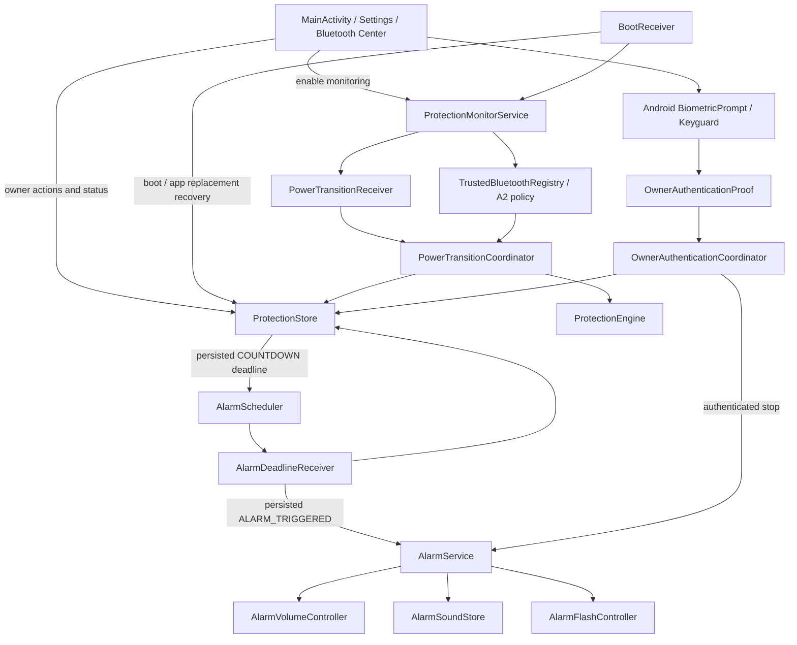

# Phase 1 — Compilation and Architecture Baseline

This document records the source-backed architecture and end-to-end ownership map for ThiefAlertSeQure. It is a navigation and verification contract, not a claim that every feature has passed its later integration or physical-device tests.

## Project invariants

- Production application ID: `com.thiefalertsequre.app`.
- Minimum Android API: 26; compile SDK and target SDK: 36.
- Java and Kotlin JVM target: 17.
- Gradle wrapper: 8.11.1.
- Debug-only test identity is separate from production identity (suffix `.v114test`, versionCode 6, versionName `1.1.4-test`).
- Charger-removal grace period: 10 seconds.
- Bluetooth A2 disconnect grace period: 8 seconds.
- A triggered alarm can only be cleared by verified owner authentication.
- Protection state and monitoring are local-first; no cloud database is part of the protection path.
- `main` is not modified by FIXALL work. No merge, tag, production release, or APK publication is authorized by this phase.

## Runtime architecture

## End-to-end feature ownership

| Feature / device event | UI and entry point | Runtime path | Durable state / Android boundary | Verification owners |
|---|---|---|---|---|
| Charger connect/disconnect | Dashboard status in `MainActivity`; runtime receiver registration in monitor | `ProtectionMonitorService` → `PowerTransitionReceiver` → `PowerTransitionCoordinator` → `ProtectionEngine` | `ProtectionStore`; Android power broadcasts and live power revalidation | `PowerTransitionCoordinatorTest`, `PowerTransitionRecoveryPolicyTest`, `ExternalPowerStateTest`; device broadcast/timing checks |
| Countdown and deadline | Dashboard state/countdown | Coordinator → `AlarmScheduler` → `AlarmDeadlineReceiver` → `ProtectionEngine` | Persisted deadline/token and boot identity in `ProtectionStore`; Android AlarmManager/exact-alarm permission | `ProtectionEngineTest`, `AlarmRecoveryPolicyTest`; exact-alarm and process-death tests |
| Alarm output | Alarm dashboard/notification | `AlarmService` → `AlarmSoundStore`, `AlarmVolumeController`, `AlarmFlashController` | Persisted triggered state; Android foreground-service, notification, audio, torch APIs | `AlarmFlashPolicyTest`, alarm recovery policy; physical audio/notification/torch tests |
| Owner disarm | `MainActivity` biometric or device-credential actions | AndroidX `BiometricPrompt` / Keyguard → verified `OwnerAuthenticationProof` → `OwnerAuthenticationCoordinator` → `ProtectionEngine.authenticated` | Android verifies credentials; app persists throttle and protection state, never PIN/password/biometric templates | `OwnerAuthenticationProofPolicyTest`, `AuthenticationThrottleTest`, crypto instrumentation; sensor/credential physical tests |
| Bluetooth A2 trust and separation | `BluetoothCenterActivity` | UI → `TrustedBluetoothRegistry`; monitor's Bluetooth receiver → trust/revision checks → A2 disconnect policy | Encrypted registry and baselines in local SharedPreferences using `LocalPreferenceCipher`; Android Bluetooth connect permission and adapter broadcasts | `TrustedBluetoothRegistryTest`, `A2DisconnectPolicyTest`, encrypted-registry instrumentation; real accessory tests |
| Boot and package replacement | No direct UI action; status reconciled in dashboard | `BootReceiver` → coordinator/store → scheduler and monitor recovery | Boot identity, persisted protection state, monitor preference; Android BOOT_COMPLETED / MY_PACKAGE_REPLACED / exact-alarm permission event | boot/recovery policy tests; reboot and first-unlock device tests |
| Settings and readiness | `SettingsActivity`, `SetupStatusActivity`, `DeviceIntelligenceActivity` | UI reads policy/snapshot helpers and launches public Android Settings intents | Android permission/settings state plus local preferences | policy unit tests, navigation verification; OEM settings physical checks |
| Theme | `ThemeActivity` | Theme UI → `ThemeStore` → runtime theme application | Local theme preference; Android window/system bar rendering | `ThemeStoreTest`; font/rotation/window device checks |
| Local event history | Settings/history UI | UI → `LocalTamperHistory` | Bounded local app-private history; user-initiated document export | source/unit coverage; export provider and data-retention checks |
| Official updates | Settings update action | `AppUpdateManager` → `AppUpdatePolicy` / version comparator → owner-initiated GitHub request and Android installer | Package/version/checksum/certificate checks; Android package installer permission | `AppUpdatePolicyTest`, `AppVersionComparatorTest`; signed update/install physical checks |
| Optional managed mode | Dashboard/settings managed-mode controls | `ManagedProtectionController` → `ThiefAlertAdminReceiver` / Android DevicePolicyManager | Android Device Admin / Device Owner policies; explicit provisioning and rollback | `ManagedPolicySnapshotTest`; dedicated managed test-device enrollment/rollback |

## Storage and security boundaries

- `ProtectionStore` is the authoritative protection-state persistence boundary. Use `updatePersisted` when subsequent side effects depend on a successful commit.
- `SafePreferences` provides typed reads so malformed values are not silently treated as ordinary defaults.
- `LocalPreferenceCipher` and Android Keystore-backed key handling protect supported local preference payloads.
- `TrustedBluetoothRegistry` owns trusted-device membership and encrypted baseline data; Android pairing remains owned by Android and is not modified by trust removal.
- `OwnerAuthenticationProof` represents app-verified Android authentication evidence. A caller-provided string is not an authorization proof.
- Android permissions and OEM policies remain external device-controlled gates. Manifest declarations do not themselves grant runtime permissions or guarantee OEM background execution.
- The app's INTERNET permission is for the optional owner-initiated updater, not for charger protection, alarm state, or Bluetooth trust.

## Build and test chain

1. `settings.gradle.kts` and root `build.gradle.kts` define project/plugin configuration.
2. There is no `gradle/libs.versions.toml` version catalog in the current tree; dependency/plugin versions are declared in `app/build.gradle.kts` and root `build.gradle.kts`. `gradle/wrapper/gradle-wrapper.properties` pins the Gradle distribution.
3. `app/build.gradle.kts` defines Android SDK levels, application identity, variants, dependencies, and Java/Kotlin target.
4. `app/src/main/AndroidManifest.xml` declares app components, exported boundaries, permissions, foreground-service types, and FileProvider.
5. `app/src/main/java` contains runtime UI, domain/policy, persistence, receivers and services.
6. `app/src/test` contains JVM policy/logic tests; `app/src/androidTest` contains Android framework, storage, crypto and compatibility instrumentation.
7. `.github/workflows/android.yml` runs unit tests, navigation checks, lint, asset/config validation, APK packaging and metadata/signature checks, then the Android API instrumentation matrix.

## Phase 1 acceptance boundary

Phase 1 is complete only when:
- the exact FIXALL branch head compiles and its unit tests pass;
- navigation, lint, asset/config checks and debug APK metadata/signature checks pass on that same head;
- architecture ownership and critical event/data paths are documented and source-checked;
- no production identity or project invariant was changed;
- unresolved Phase 1 findings are either fixed and re-run or explicitly identified as blockers (never represented as passed).

Emulator and physical-device behavior remain separately tracked in later phases. A green build does not certify real charger broadcasts, Bluetooth accessories, OEM background policies, alarm audio, biometric hardware, or reboot behavior.
